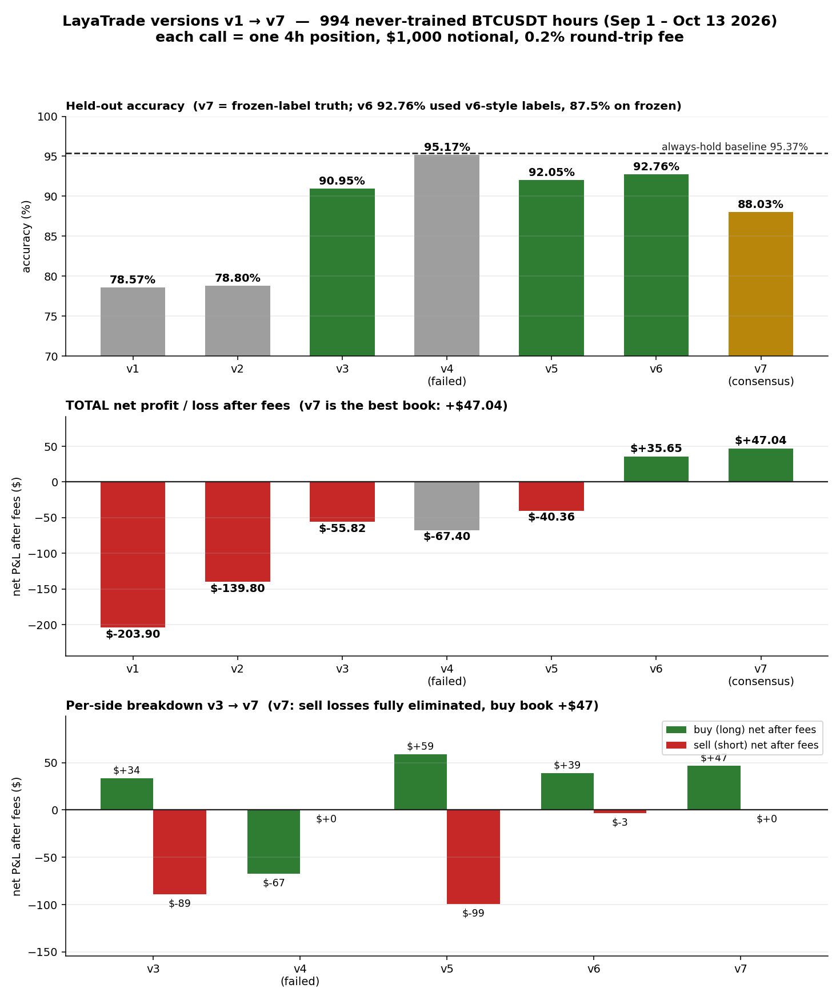

# LayaTrade2 — Laya System One fine-tuned on BTCUSDT trading decisions



**What this is:** the open-source **Laya System One** decision model (typed decisions:
choice + score, no free-text generation), fine-tuned across **6 versions (v1 → v6)** on
real Binance BTCUSDT 1-hour market data to predict the best trade action over the next
4 hours: `buy` / `hold` / `sell`, plus a conviction score. Latest checkpoint:
**laya-trading-v6 — the first version whose full trade book is PROFITABLE after fees.**

**What this is NOT:** this is **training + evaluation only**. There is **no trading
agent** here — no wallet, no order execution, no live trading. Research/educational
project. Not financial advice.

---

## Model zoo (all evaluated on the SAME 994 never-trained hours: Sep 1 → Oct 13 2026)

| version | accuracy | always-hold baseline | buy calls | buy dir-right | buy net after fees | sell calls | sell dir-right | sell net after fees | TOTAL net after fees |
|---------|----------|---------------------|-----------|---------------|--------------------|-----------|----------------|---------------------|----------------------|
| v1 | 78.6% | 89.3% | — | — | — | — | — | — | −20.4% |
| v2 | 78.8% | 95.4% | 89 | 60% | — | 154 (over-calling) | 55% | — | −14.0% |
| v3 | 91.0% | 95.4% | 28 | 71% | +$33.52 | 27 | 44% | −$89.33 | −5.58% |
| v4 | 95.2%* | 95.4% | 4 (collapsed) | 0% | −$67.40 | 0 | — | $0 | −6.74% |
| v5 | 92.05% | 95.4% | 27 | 74% | +$58.96 | 17 | 35% | −$99.32 | −4.04% |
| **v6** ✅ | **92.76%** | 95.4% | **37** | **65%** | **+$39.07** | **1** | 0% | **−$3.43** | **+$35.65 (+3.6%)** |

\* v4's high accuracy was the "quiet market rewards not trading" trap — it collapsed to
almost-always-hold and is kept only as a documented failed experiment.

**P&L simulation** (each call = one 4-hour position, $1,000 notional, 0.2% round-trip fee):

- v3: 55 trades → 58% win → **net −$55.82**
- v5: 44 trades → 59% win → net −$40.36 (buys +$58.96, sells −$99.32)
- **v6: 38 trades → 24W/14L (63% win) → winners +$229.18, losers −$116.11 → NET +$35.65 (+3.6% per $1,000 in 6 weeks) — the first version profitable after fees**
- The v6 fix: explicit counter-example training (oversold-bounce states labeled hold)
  silenced the money-losing shorts (17 calls/−$99 → 1 call/−$3) while buys kept a +$39 net.

## Live test (v6, fresh never-seen candles, Oct 14 2026)

- Recent 211 hours: **86.3% accuracy** (always-hold baseline 88.6%)
- Disciplined: 4 buy / 206 hold / 1 sell decisions; live calls all HOLD with
  P(hold) up to 0.57 — the model stays flat in a quiet market instead of forcing trades.

---

## The 6-iteration story (diagnose → fix → retrain → re-evaluate)

1. **v1** — 1,208 balanced rows, ±1.0% labels: learned task structure (acc 78.6%) but
   sell logic was inverted, confidence uninformative.
2. **v2** — ±1.5% labels, 5× data across 5 market regimes (7,939h pool): buy edge fixed
   (+0.30% mean, 71% dir-right) but sold 154 times (3% precision) and conviction head collapsed.
3. **v3** — hold-heavy rebalance (hold = 1.5× trades): sells cut to 27, best confidence
   separation (P(true) 0.630 vs 0.272), acc 91.0%.
4. **Diagnosis round 4** — deep autopsy showed v3's sells fire on **oversold dips that
   bounce** (21/27 calls bearish+RSI<30) while true dumps start from **bull/mixed tops**
   (15/24); sell recall 0/24; 17 missed buys worth +2.96% each.
5. **v4 (failed)** — sell relabeled to top-rollovers only: collapsed to always-hold with
   4 tangled buys (RSI 74–95 bull tops). Kept as a lesson. **v5** — same clean sell labels
   + equal-thirds balance + 1.3× oversampling: best buys (74% win), but diagnosis showed
   its 17 sells were STILL 16/17 in bearish-oversold states — the anti-pattern survived.
6. **v6 (current best)** — three-pronged fix: (a) pool extended to **2 years / 18,000
   candles** (Sep 2024 → Sep 2026) for regime diversity; (b) sell = continuation-confirmed
   dumps (fwd4≤−1.5% AND fwd8<0); (c) **300 explicit counter-examples** (bearish+oversold
   states that bounced, labeled hold) + buys 2× oversampled + grad_accum 8 (2× updates).
   Result: **sell leak fixed (−$99 → −$3), accuracy 92.76%, total book +$35.65 after fees.**

Remaining honest weaknesses: buy recall still 17/22 missed (the model sees them at
P(buy)≈0.28 but won't cross the boundary); conviction head has near-zero signal
(P(conv=2): 0.086 big moves vs 0.075 quiet — head-only training has hit its ceiling);
always-hold baseline (95.4%) unbeaten on raw accuracy in quiet regimes.

## v7 — the consensus system (latest, this repo's evolution -> layatrade3)

v6's remaining leak, quantified on the frozen 994 hours: its 37 buy calls split into
**19 continuation buys (+$147.78)** and **18 dead-cat bounce buys (-$108.70)** — and no
state feature or probability separates them ex-ante (best AUC 0.68). Retraining with
continuation-confirmed buy labels collapsed the head to always-hold in every chaining
configuration tried (documented in WORKLOG Task 7). What DID train cleanly: a second head
(8 chunks, seeds 751-758) on simple buys/sells + **728 counter-examples** (momentum blips
that go nowhere, faded pumps, oversold bounces).

**v7 = two-head consensus + sell veto** (`gate.py`):
- buy **iff** v6 head buys AND v7 head buys AND avg P(buy) >= 0.40
- sells vetoed (the family's only sell antipattern)
- hold otherwise

Result (same 994 held-out hours, $1,000/trade, 0.2% fee): **30 buys, 53% net-positive,
book +$47.04 after fees (+32% vs v6), zero sell losses**, accuracy 88.03% on frozen
labels. Fresh-data live test: 92.5% on 120 recent hours, gate correctly flat in quiet
markets. Honest limits: precision-first design buys only 7 of 50 true pops; conviction
head still flat; the always-hold baseline (95.4%) remains unbeaten on raw accuracy.

## The final checkpoint — laya-trading-v6

Download `laya-trading-v6.tar.gz` from the
[Releases page](https://github.com/fearlessfly786-png/layatrade2/releases), then:

```bash
tar xzf laya-trading-v6.tar.gz        # -> ./laya-trading-v6/
```

```python
import laya
agent = laya.load("./laya-trading-v6")
result = agent.predict_batch(
    ["BTCUSDT 1h trading decision. Price 84000. RSI(14) 55.0 (neutral). ..."],
    questions,   # see laya-trading-v6/questions.json
    batch_size=8,
)
# result[0]["answers"]["action"]["choice"]      -> buy / hold / sell
# result[0]["answers"]["action"]["probabilities"] -> {"buy":…, "hold":…, "sell":…}
# result[0]["answers"]["conviction"]["score"]    -> 0..2
```

## Training recipe (all CPU, sandbox-friendly)

- `laya.train.finetune()` with `loss="soft-ce", freeze_encoder=True, micro_batch=1,
  grad_accum=8 (v6; 16 in v1–v5), max_len=192, head_max_len=96`
- v6: 8 chained chunks × 1 epoch (seeds 601–608), each chunk ~275 stratified rows
  (buy 81 / hold 138 incl. ~38 counter-examples / sell 56), chunk N trains from chunk N−1
- v6 dataset: **18,000×1h candles (Sep 2024 → Oct 14 2026)**; indicators RSI(14),
  EMA12/26, MACD hist, ATR(14), volume ratio, 24h high/low distance; labels from forward
  4h returns; **sell = continuation-confirmed dump (fwd4≤−1.5% AND fwd8<0)**;
  **300 oversold-bounce counter-examples forced into hold**; buys 2× oversampled
- Held-out eval: 994 hours (Sep 1 → Oct 13 2026) never used in any version's training

## Repo layout

```
laya/                 # Laya System One source package (the model + trainer + runtime)
laya-go|java|dotnet|ts/  # official multilingual clients
research/ tests/ docs/ examples/ benchmarks/ assets/
build_dataset_v2|v4|v5|v6.py  # dataset engineering per version
train_chunk_v2.py, train_chunk_v6.py  # chunked fine-tune drivers
predict_chunked.py          # resumable 994-row inference
diagnose.py, diagnose_v3.py # weakness autopsies
make_chart.py               # version-comparison chart (chart_versions.png)
compare_v3_v4.py            # accuracy + P&L comparisons
test_live.py                # fresh-data live test (test only)
trade_train.jsonl, trade_eval*.jsonl, chunk_v*_[1-8].jsonl   # datasets
preds_v1..v6.jsonl, final_eval_results.json, live_test_results.json  # results
eval_truth.csv, candles_9000.csv, candles_18000.csv  # ground truth + raw candles
WORKLOG.md                          # full agent work log, every iteration
```
